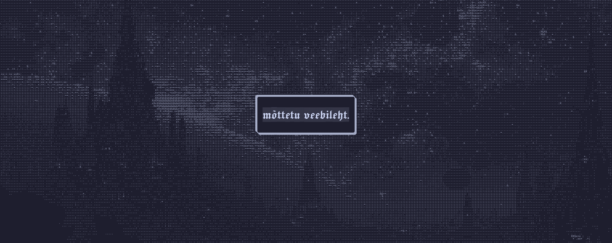

<strong>

Täiesti mõttetu veebileht...
 

 
Tartu Ülikooli LTAT.03.002 põhine projekt
</strong>

### Mis see on?
Kui keegi ei saanud veel aru, siin ei ole mingit otstarvet. Kõik mis selles lehes on, on mõttetu. Aga mõttetu ei tähenda, et see on igav. 😉

Siin saab katsetada oma edu ja uurida kuhu sa sattud sel korral. kord on juhuslik ja lisaks täiesti mõttetu (nagu veebileht).

Ainukene eesmärk mida sel veebilehel ikkagi võib olla on tekitada emotsioone ✨

Ühesõnaga, me püüame teie vaimse tervise jaoks ❤️❤️

Naermine pikendab elu, eks?

#### Arendajad:
- Karl Kaspar Meier 🤫
- Konstantin Razdolski 🪤🍻
- Jaan Sööt 🫡